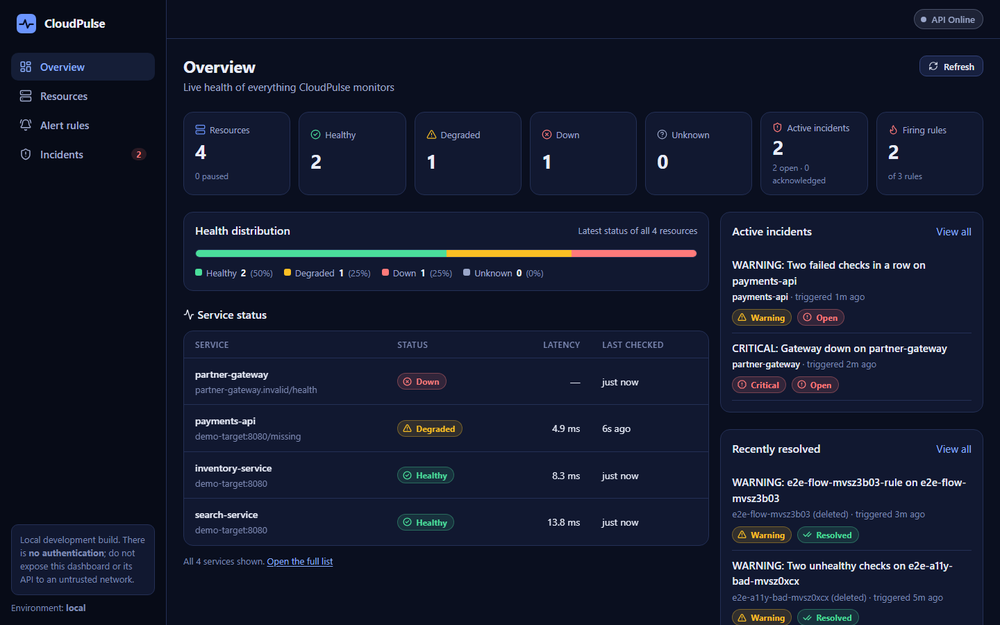
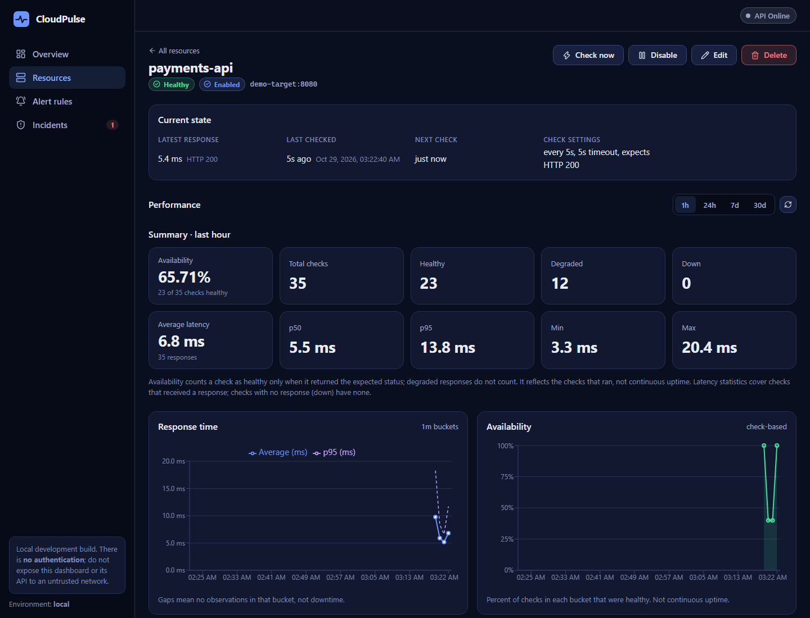
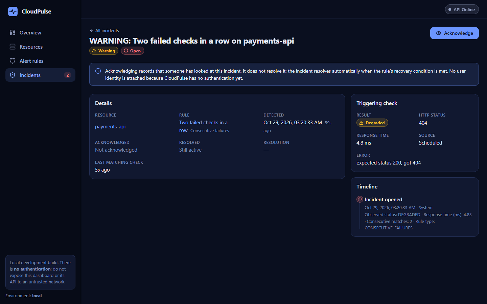
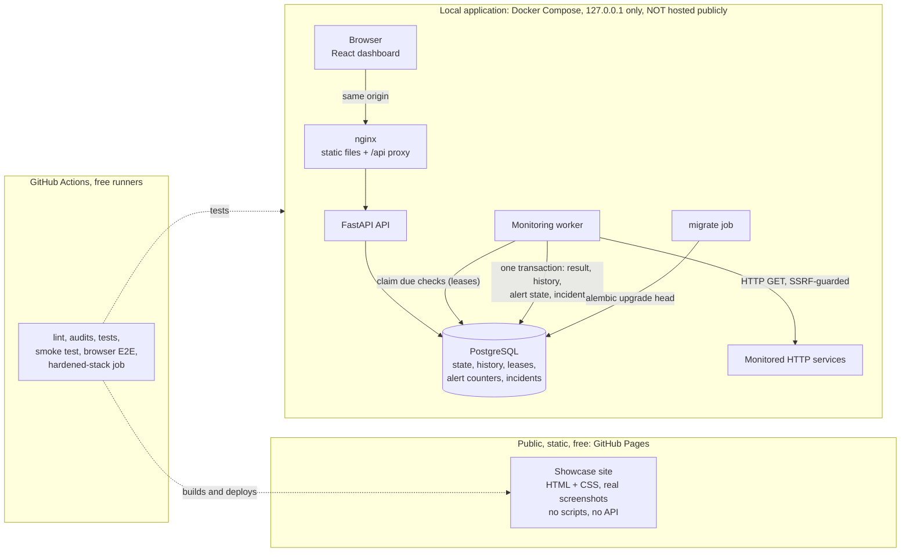

# CloudPulse

[](https://github.com/gladwynL/CloudPulse/actions/workflows/ci.yml)
[](https://github.com/gladwynL/CloudPulse/actions/workflows/pages.yml)

**CloudPulse** is a monitoring, alerting and incident-management platform for HTTP services. A
dedicated worker checks your services on a schedule; every result is stored as history with
availability and latency statistics; alert rules turn bad checks into incidents that you acknowledge
and that resolve themselves on recovery. Backend in **Python / FastAPI / PostgreSQL**, dashboard in
**React / TypeScript**, everything started with one `docker compose up`.

**[View the public showcase](https://gladwynl.github.io/CloudPulse/)** · [Source](https://github.com/gladwynL/CloudPulse) · [Quick start](#quick-start) · [Architecture](#architecture)

> **What is public and what is not.** The showcase above is a **static page** (real screenshots, no
> scripts, no API). The application itself runs **locally** and is **not hosted publicly**: it has no
> authentication yet, so it is deliberately not exposed to a network. Nothing in this project uses a
> cloud account or a paid service. See [Security and limitations](#security-and-limitations).



|  |  |
| --- | --- |
|  |  |
| *Per-resource availability, latency percentiles and history* | *An incident: trigger, rule and timeline* |

All screenshots are of the real application with synthetic services (`docs/screenshots/`).

## Contents

[Key capabilities](#key-capabilities) ·
[Engineering highlights](#engineering-highlights) ·
[Architecture](#architecture) ·
[Technology stack](#technology-stack) ·
[Quick start](#quick-start) ·
[A monitoring and alerting example](#a-monitoring-and-alerting-example) ·
[API overview](#api-overview) ·
[Testing and CI](#testing-and-ci) ·
[Local deployment and recovery](#deployment-local-production-style) ·
[Security and limitations](#security-and-limitations) ·
[Future work](#roadmap) ·
[Reference sections](#repository-structure)

## Key capabilities

- **Monitor** HTTP(S) services on a schedule (interval, timeout, expected status), plus on-demand checks.
- **History and metrics**: every check is kept (30 days by default); availability, min/avg/max, p50/p95
  latency and time-bucketed series are served by the API.
- **Alert rules**: consecutive unhealthy checks, a latency threshold, or an immediate status, each with
  its own recovery condition.
- **Incidents**: one per problem, acknowledged by hand, resolved automatically on recovery, with a
  durable event timeline that outlives the resource.
- **Dashboard**: overview, resources, charts, history, rules and incidents; responsive from a phone to
  a wide desktop; keyboard and screen-reader accessible.
- **Operable**: health and readiness probes, JSON logs, a hardened Compose profile, tested backup and restore.

## Engineering highlights

These are the parts worth reading the code for.

- **PostgreSQL-based check leases.** The worker claims due resources with
  `FOR UPDATE SKIP LOCKED` and stamps a lease token and expiry on the row, so a check never runs twice
  and a crashed worker's checks are reclaimed when the lease expires. No queue, Redis or Celery.
- **SSRF defence with DNS-rebinding protection.** The URL is validated when saved, and the *resolved*
  addresses are checked and pinned at connect time: the client connects to the validated literal and
  never re-resolves the name, so a DNS answer that changes between check and connect cannot reach a
  private or cloud-metadata address. TLS is verified, redirects are not followed, and errors are
  sanitized. ([details](#network-safety-ssrf))
- **One transaction per check.** The latest state, the history row, the alert-rule counters and any
  incident are written atomically, with a fixed lock order (resource, rules, incidents). A crash or
  restart cannot leave a result without its history, or a counter without its check.
- **Incident deduplication enforced by the database.** A partial unique index allows at most one active
  (open or acknowledged) incident per rule, a backstop behind the application's row lock; concurrency
  tests exercise it against real PostgreSQL.
- **A deterministic recovery state machine.** Rule evaluation is a pure function of persisted counters
  (failure streak, recovery streak), so restarts, reconfiguration and replays behave identically.
- **Honest availability.** Availability is *check-based* (healthy checks over checks that ran), labelled
  as such everywhere, with gaps in charts shown as gaps, never as downtime.
- **Hardened, verified deployment.** A Compose profile publishes only the web port on loopback, runs
  read-only containers with capabilities dropped, and serves the API through an nginx proxy. Startup
  order, a database outage under a running worker, and profile switching were exercised end to end.
- **Real browser end-to-end tests.** Playwright drives the actual dashboard against the Docker stack
  through the whole loop (add a service, break it, see the incident, acknowledge, fix, resolve, delete),
  fails on any console error, and runs axe-core WCAG checks.
- **Backups that are proven, not assumed.** `scripts/db_backup.py` writes checksummed backups, verifies
  them by restoring into a disposable container, and can only restore into a new or empty database.

## Architecture



- **api** (FastAPI): resource, history, metrics, alert-rule and incident endpoints plus probes. It never
  polls; it checks only when asked (a manual check).
- **worker**: the single polling process, same image as the API. Claims due resources, checks them with
  bounded concurrency, and persists the outcome together with alert evaluation. Also runs retention.
- **db** (PostgreSQL 17): the source of truth for configuration, latest state, scheduling and leases,
  history, rules and incidents.
- **migrate**: a one-shot job; the API and worker start only after it succeeds.
- **frontend**: static React build served by nginx, which also proxies `/api`, `/health` and `/ready`
  to the API in the hardened profile.

Layering inside `backend/app/`: `api` (HTTP) → `services` (rules) → `repositories` (SQL), with
`monitoring` (checker, SSRF policy, scheduler) and `alerting` (pure evaluator, engine) shared by the API
and worker. The public showcase and the application are completely separate: the page makes no network
calls and has no way to reach a local backend. More: [`docs/architecture.md`](docs/architecture.md); a
*design-only* cloud variant: [`docs/cloud-reference-architecture.md`](docs/cloud-reference-architecture.md).

## Technology stack

| Area | Technology |
| --- | --- |
| Backend | Python 3.12, FastAPI, SQLAlchemy 2, Alembic, psycopg 3, Pydantic Settings, httpx |
| Database | PostgreSQL 17 |
| Frontend | React 19, TypeScript, Vite, React Router, TanStack Query, Recharts |
| Testing | Pytest (real PostgreSQL), Vitest + Testing Library, Playwright, axe-core |
| Quality | Ruff, ESLint, Prettier, `pip-audit`, `npm audit` |
| Infrastructure | Docker, Docker Compose, nginx, GitHub Actions, GitHub Pages |

## Quick start

You need **Git** and **Docker** (Python 3.12 only for the helper scripts).

```bash
git clone https://github.com/gladwynL/CloudPulse.git
cd CloudPulse
python scripts/init_env.py                       # creates .env with a generated database password
docker compose up --build --detach --wait
```

Open **http://localhost:3000** for the dashboard (API docs at http://localhost:8000/docs). To try it with
something to monitor, start the bundled demo target and follow the
[demo walkthrough](#try-it-with-the-demo-target). Useful commands:

```bash
docker compose ps                                 # status and health
python scripts/smoke_test.py --docker-control     # full check, alert, incident, recovery loop (needs the demo target)
python scripts/db_backup.py backup                # back up the database (and `verify` it, see below)
docker compose stop                               # stop without deleting data
```

Windows PowerShell works the same (set environment variables with `$env:NAME = "value"`). The hardened
profile, backups and the CI-identical checks are covered under
[Deployment](#deployment-local-production-style) and [Backup and recovery](#backup-and-recovery).

## A monitoring and alerting example

With the demo target running (see the walkthrough below), register a service that answers `404`, which
CloudPulse reports as *degraded*, and open an incident after two bad checks in a row:

```bash
curl -s -X POST localhost:8000/api/v1/resources -H 'Content-Type: application/json' \
  -d '{"name":"reports","url":"http://demo-target:8080/missing","check_interval_seconds":10}'
# note the "id", then:
curl -s -X POST localhost:8000/api/v1/resources/<id>/alert-rules -H 'Content-Type: application/json' \
  -d '{"name":"Two unhealthy checks","rule_type":"CONSECUTIVE_FAILURES","consecutive_failures":2,"recovery_successes":2}'
curl -s "localhost:8000/api/v1/incidents?active=true"      # the incident appears after about 20 seconds
```

Acknowledge it (`POST /api/v1/incidents/<id>/acknowledge`), change the resource's expected status to
`404` (or point it at `/`) and it resolves automatically after two healthy checks, with a timeline of
`OPENED`, `ACKNOWLEDGED` and `RECOVERED`. The dashboard shows all of this live; the browser test
`frontend/e2e/workflow.spec.ts` does exactly this loop.

## API overview

REST under `/api/v1` (interactive docs at `/docs` in the development stack), with a consistent
`{"detail": ...}` error envelope, validated inputs, bounded pagination (offset for lists, keyset cursors
for history and incidents) and UTC ISO-8601 timestamps.

| Area | Endpoints |
| --- | --- |
| Resources | `GET/POST /resources`, `GET/PATCH/DELETE /resources/{id}`, `POST /resources/{id}/check` |
| History and metrics | `GET /resources/{id}/checks`, `/metrics/summary`, `/metrics/timeseries` |
| Alert rules | `GET /alert-rules`, `GET/POST /resources/{id}/alert-rules`, `PATCH/DELETE /alert-rules/{id}` |
| Incidents | `GET /incidents`, `GET /incidents/{id}`, `POST /incidents/{id}/acknowledge`, `GET /incidents/{id}/events` |
| Overview and probes | `GET /overview`, `GET /health`, `GET /ready` |

The detailed semantics are in the [monitoring guide](#monitoring-guide),
[history and metrics](#history-and-metrics) and [alerts and incidents](#alerts-and-incidents) sections.

## Testing and CI

| Layer | What | Count / tool |
| --- | --- | --- |
| Backend | unit and PostgreSQL integration tests (leases, atomicity, alert concurrency, retention, SSRF, deployment tooling) | 764 tests, Pytest |
| Frontend | components, API-client contract (404/409/422/503/network), forms, pages, charts, routing | 225 tests, Vitest + Testing Library |
| Browser | the full workflow, outage behaviour, responsive layout, WCAG A/AA (axe-core), the showcase site | 38 tests, Playwright |
| Stack | check, alert, incident, restart-recovery loop on real containers | `scripts/smoke_test.py` |

CI runs on free GitHub-hosted runners: backend (lint, `pip-audit`, migrations, tests), frontend (lint,
`npm audit`, types, tests, build), the development stack (smoke test and browser tests), and a hardened
stack job (port audit, smoke test through the proxy, backup verification, browser tests). Details:
[Testing and linting](#testing-and-linting) and [Continuous integration](#continuous-integration).

## Security and limitations

- **No authentication or authorization.** Anyone who can reach the dashboard or API can change or delete
  data and trigger outbound checks. The stack therefore binds to `127.0.0.1` (the hardened profile
  publishes only the web port) and is for a trusted machine. Loopback binding limits who can reach it; it
  is not authentication. **Authentication and authorization are prerequisites for any public backend,
  and this project does not claim to be safe for public SaaS use.**
- The public showcase is static and cannot reach the local backend.
- Notifications (email, chat, webhooks) are **not implemented**; incidents are read in the dashboard or API.
- Availability is check-based, not continuous uptime. One worker; no clustering. No multi-tenancy.
- No cloud deployment exists, and none was paid for; a design-only reference lives in `docs/`.
- Measurements in this README were taken on one laptop and are not production benchmarks.

Full details: [Security and deployment limitations](#security-and-deployment-limitations).

## Future work

Authentication and authorization (the gate for any public backend); notification delivery, designed to
read `incident_events` outside the check transaction; multi-worker load testing; downsampled long-term
history. See the [roadmap](#roadmap).

---

## Reference

The sections below are the detailed reference: repository layout, setup, the monitoring, metrics and
alerting semantics, the dashboard, deployment, backup and recovery, the showcase, security details,
configuration, development without Docker, migrations, testing, CI, portability and the roadmap.

## Repository structure

```
CloudPulse/
├── backend/
│   ├── app/
│   │   ├── api/            # routers (health, resources), dependencies, error mapping
│   │   ├── core/           # settings, structured logging, request middleware
│   │   ├── db/             # engine/session management, declarative Base
│   │   ├── alerting/       # evaluator (pure state machine), engine, incident lifecycle
│   │   ├── models/         # resource, check result, alert rule, incident, event, enums
│   │   ├── monitoring/     # checker, SSRF policy + guarded network backend,
│   │   │                   #   executor, scheduler, lease store, retention
│   │   ├── repositories/   # SQL: CRUD, lease/claim/complete, history queries, retention
│   │   ├── schemas/        # Pydantic request/response models
│   │   ├── services/       # resource rules, readiness check
│   │   ├── main.py         # create_app() factory
│   │   └── worker.py       # `python -m app.worker`
│   ├── alembic/            # migrations (0001 baseline … 0004 alerting)
│   ├── tests/              # unit tests + PostgreSQL integration tests
│   ├── pyproject.toml, requirements*.txt, Dockerfile
├── frontend/               # React dashboard (src/app, features/, components/, lib/), e2e/ (Playwright)
├── site/                   # the static GitHub Pages showcase (HTML + CSS, no scripts)
├── scripts/                # smoke_test.py, db_backup.py, init_env.py, check_ports.py, build_site.py (stdlib only)
├── infra/                  # notes only: no cloud infrastructure exists or is planned to be created here
├── docs/                   # architecture.md, cloud-reference-architecture.md, screenshots/
├── .github/workflows/      # ci.yml (backend, frontend, docker, hardened), pages.yml (showcase)
├── docker-compose.yml      # development stack
├── docker-compose.hardened.yml   # production-style local override
├── .env.example
└── README.md
```

## Prerequisites

| Tool                                 | Version          | Needed for                          |
| ------------------------------------ | ---------------- | ----------------------------------- |
| Git                                  | any              | everything                          |
| Docker Desktop / Engine + Compose v2 | recent           | running the full stack              |
| Python                               | 3.12.x           | backend development without Docker  |
| Node.js                              | 22+ (CI uses 24) | frontend development without Docker |

Only Git and Docker are required to run the stack.

## Docker Compose reference

```bash
python scripts/init_env.py    # creates .env with a generated database password (never overwrites)
docker compose up --build
```

(Prefer to do it by hand? `cp .env.example .env` — PowerShell: `Copy-Item .env.example .env` — then set
`POSTGRES_PASSWORD`; the file explains how to generate one.)

| Service    | URL                                        |
| ---------- | ------------------------------------------ |
| Frontend   | http://localhost:3000                      |
| API + Swagger UI | http://localhost:8000/docs           |
| PostgreSQL | `localhost:5432` (credentials from `.env`) |

All published ports bind to `127.0.0.1`. Startup order is enforced with health checks:
`db` (healthy) → `migrate` (completed) → `backend` and `worker` (healthy) → `frontend`.

```bash
docker compose up --build -d        # start in the background
docker compose ps                   # service status and health
docker compose logs -f worker       # follow the worker's check logs (JSON lines)
docker compose logs -f backend      # follow API logs
docker compose run --rm migrate     # re-run migrations
docker compose down                 # stop (data is kept)
docker compose down -v              # stop and DELETE the local database volume
```

### Try it with the demo target

Monitored URLs must pass the [network safety](#network-safety-ssrf) policy, which blocks
private addresses, so a local service needs an explicit development-only allowlist. The
Compose file ships a tiny nginx (`demo-target`, profile `demo`) for exactly this:

```bash
# bash/zsh:
MONITORING_ALLOWED_LOCAL_HOSTS=demo-target:8080 docker compose --profile demo up --build -d
# PowerShell:
$env:MONITORING_ALLOWED_LOCAL_HOSTS="demo-target:8080"; docker compose --profile demo up --build -d
```

Then follow the [monitoring guide](#monitoring-guide) using `http://demo-target:8080/`
(healthy) and `http://demo-target:8080/missing` (returns 404 → `DEGRADED`).
`docker compose stop demo-target` makes them `DOWN`. An automated version of this walkthrough:

```bash
MONITORING_MIN_INTERVAL_SECONDS=5 MONITORING_ALLOWED_LOCAL_HOSTS=demo-target:8080 \
  docker compose --profile demo up --build --wait
python scripts/smoke_test.py --docker-control
```

## Monitoring guide

### Resource model

| Field | Meaning |
| --- | --- |
| `id` | UUID, server-generated |
| `name`, `description` | Human-readable label (name ≤ 100 chars) |
| `url` | `http`/`https` endpoint; checked with `GET` |
| `is_enabled` | Whether the worker schedules checks |
| `check_interval_seconds` | Time between checks (default 60; bounds 10–86400) |
| `timeout_seconds` | Hard deadline for a check (default 10; max 30; ≤ interval) |
| `expected_status_code` | HTTP status that counts as healthy (default 200) |
| `current_status` | `UNKNOWN`, `HEALTHY`, `DEGRADED`, or `DOWN` |
| `last_checked_at`, `next_check_at` | UTC timestamps |
| `last_response_time_ms` | Time until response headers arrived (null if no response) |
| `last_http_status_code`, `last_error` | Latest observation; `last_error` is a sanitized summary |

### Health states

| State | Meaning |
| --- | --- |
| `UNKNOWN` | No completed check yet, or the check configuration changed since the last one |
| `HEALTHY` | A response arrived with the expected status code |
| `DEGRADED` | A response arrived with a *different* status code (the service answered, but unhealthily). Redirects are **not** followed, so a 3xx is DEGRADED unless it is the expected status |
| `DOWN` | The check could not complete: timeout, DNS failure, connection failure, TLS failure, or a target blocked by the network policy |

`last_error` is a fixed, sanitized string such as `timeout: no response within 10s` or
`expected status 200, got 503`. Raw exception text and URLs are never stored or logged.

### API

Interactive docs: http://localhost:8000/docs

| Method | Endpoint | Purpose |
| --- | --- | --- |
| `POST` | `/api/v1/resources` | Create a resource (201, `Location` header) |
| `GET` | `/api/v1/resources` | List: `limit` (1–200, default 50), `offset`, `is_enabled`, `current_status`; ordered by creation time then id |
| `GET` | `/api/v1/resources/{id}` | Details |
| `PATCH` | `/api/v1/resources/{id}` | Partial update, including enable/disable |
| `DELETE` | `/api/v1/resources/{id}` | Delete (204) |
| `POST` | `/api/v1/resources/{id}/check` | Run a check now and return the resulting status |
| `GET` | `/api/v1/resources/{id}/status` | Latest health (compact view) |

Errors use FastAPI's `{"detail": ...}` envelope: `404` unknown resource, `422` invalid input
(including unsafe URLs, out-of-range intervals, malformed UUIDs), `409` for a manual check that
cannot run.

```bash
# Register a service (no outbound request happens at registration; the first check is scheduled)
curl -s -X POST localhost:8000/api/v1/resources -H 'Content-Type: application/json' \
  -d '{"name": "Billing API", "url": "https://example.com/health", "check_interval_seconds": 30}'

# Inspect the current status (use the "id" from the response)
curl -s localhost:8000/api/v1/resources/<id>/status

# Trigger a manual check
curl -s -X POST localhost:8000/api/v1/resources/<id>/check

# Disable monitoring (keeps the last observation, stops scheduling)
curl -s -X PATCH localhost:8000/api/v1/resources/<id> -H 'Content-Type: application/json' \
  -d '{"is_enabled": false}'
```

### Update, enable/disable, and manual-check semantics

- A new enabled resource is **due immediately** (status `UNKNOWN` until the first check).
- **Disabling** clears `next_check_at` and drops any in-flight lease: a check already running is
  discarded when it finishes, and nothing further is scheduled. The **last observed status and
  result are retained**. Re-enabling makes the resource due immediately.
- Changing `url`, `timeout_seconds`, or `expected_status_code` **invalidates** the previous
  observation (status → `UNKNOWN`, last-result fields cleared, in-flight check discarded) and
  schedules a fresh check. Changing only the name, description, or interval keeps the
  observation; an interval change reschedules relative to the last check.
- A **manual check** uses the same lease as scheduled checks, so it can never overlap one: it
  returns `409` if a check is already running, if the resource is disabled, or if the resource
  was changed/deleted while the check ran (the result is then discarded). It restarts the
  resource's interval timer. Its duration is bounded by the resource's timeout.

## History and metrics

Every check whose result is **accepted** (see [atomic persistence](#atomic-persistence)) appends
one row to `resource_check_results`. History is independent of the latest state: disabling or
reconfiguring a resource never alters what was recorded, and deleting a resource deletes its
history (database `ON DELETE CASCADE`, so orphans cannot exist).

### What a history row means

| Field | Meaning |
| --- | --- |
| `checked_at` | **Event time**: when the result was accepted, from the database clock. It is the transaction timestamp of the write that also updates the resource, so it equals the resource's `last_checked_at` for that check. All queries and buckets use it. |
| `created_at` | When the row was physically inserted (a few ms later). Audit only. |
| `status` | `HEALTHY`, `DEGRADED`, or `DOWN` (never `UNKNOWN`) |
| `http_status_code` | Status of the response; null when no response arrived |
| `response_time_ms` | **HTTP latency**: time until response headers arrived; null for `DOWN` |
| `duration_ms` | **Execution time** of the check (including DNS, failures and timeouts); never null. Not the same as latency. |
| `error_category`, `error_summary` | Sanitized, fixed text only (e.g. `timeout`, `timeout: no response within 10s`) |
| `source` | `SCHEDULED` or `MANUAL` |

Timestamps are timezone-aware UTC. `response_time_ms` and `duration_ms` are `NUMERIC(10,2)`;
values are rounded once, in Python, before insert, so the database never re-rounds. Database
constraints reject negative times, out-of-range HTTP codes, and `status = UNKNOWN`. No response
bodies, URLs, credentials, or raw exception text are stored.

### Atomic persistence

`repo.complete()` is the single place a check result becomes authoritative, used identically by
scheduled and manual checks (there is no separate history path). In **one transaction** it:

1. updates the resource's latest state `WHERE id = … AND lease_token = <mine>` (the lease gate);
2. if (and only if) that matched a row, inserts the history row;
3. commits.

Consequences, each covered by PostgreSQL tests:

- If the insert fails, the state update rolls back with it; the lease stays held until it expires
  and the check is retried. Nothing is half-written.
- A result discarded because the lease was lost (stale or expired lease, resource deleted,
  disabled, or reconfigured mid-check) inserts **no** history.
- Completing the same claim twice, or two workers racing to complete it, records exactly one row.
- The HTTP request runs entirely outside the transaction; no row lock is held during the call.

### Endpoints

All three require an existing resource (`404` otherwise) and share the same window rules.

| Method | Endpoint | Purpose |
| --- | --- | --- |
| `GET` | `/api/v1/resources/{id}/checks` | History, newest first. `start`, `end`, `status`, `limit`, `cursor` |
| `GET` | `/api/v1/resources/{id}/metrics/summary` | Counts, availability, latency statistics. `start`, `end` |
| `GET` | `/api/v1/resources/{id}/metrics/timeseries` | Per-bucket aggregates. `start`, `end`, `interval` |

**Windows and timestamps.** Windows are **half-open `[start, end)`** (start inclusive, end
exclusive), so adjacent windows never double-count. Timestamps are ISO 8601; naive values are read
as UTC and offsets are converted. Responses are UTC (`…Z`). A literal `+` in a query string must be
URL-encoded (`%2B`); prefer `Z`. Defaults: `end` = now, `start` = `end − 24 h`. Validation (`422`):
malformed timestamps, `start >= end`, windows wider than `METRICS_MAX_QUERY_DAYS` (30), unsupported
query parameters (rejected, not ignored), and invalid `limit`/`cursor`/`status`/`interval`.

**Pagination is keyset (cursor) based**, not offset based. Rows are ordered `(checked_at DESC,
id DESC)` — the `id` tie-break makes the order total — and `next_cursor` encodes the last row's
position. Unlike offsets, this stays correct and fast while new rows arrive during paging (no
duplicates or skips) and never scans past skipped rows. The trade-offs: no total count (it would
need another scan) and no jumping to arbitrary page numbers. `limit` is 1–200 (default 50); pass
`next_cursor` back as `cursor` with the same filters.

```bash
# last 24 hours of history, newest first (default window and page size)
curl -s localhost:8000/api/v1/resources/<id>/checks
# failures in a specific window; fetch the next page with the returned cursor
curl -s "localhost:8000/api/v1/resources/<id>/checks?status=DOWN&start=2026-03-10T12:00:00Z&end=2026-03-10T14:00:00Z&limit=2"
curl -s "localhost:8000/api/v1/resources/<id>/metrics/summary?start=2026-03-10T12:00:00Z&end=2026-03-10T14:00:00Z"
curl -s "localhost:8000/api/v1/resources/<id>/metrics/timeseries?start=2026-03-10T12:00:00Z&end=2026-03-10T14:00:00Z&interval=5m"
```

History (`next_cursor` is `null` on the last page):

```json
{
  "resource_id": "6f9c1d1e-5a1e-4a52-9d52-2d6a0f4f2e11",
  "window": {"start": "2026-03-10T12:00:00Z", "end": "2026-03-10T14:00:00Z"},
  "items": [
    {"id": "…", "checked_at": "2026-03-10T13:06:00Z", "status": "DOWN", "http_status_code": null,
     "response_time_ms": null, "duration_ms": 10002.41, "error_category": "dns",
     "error_summary": "dns: hostname could not be resolved", "source": "SCHEDULED",
     "created_at": "2026-03-10T13:06:00.002Z"}
  ],
  "limit": 2,
  "next_cursor": "eyJ0IjogIjIwMjYtMDMtMTBUMTM6MDY6MDArMDA6MDAiLCAiaSI6ICIuLi4ifQ"
}
```

Summary:

```json
{
  "resource_id": "6f9c1d1e-5a1e-4a52-9d52-2d6a0f4f2e11",
  "window": {"start": "2026-03-10T12:00:00Z", "end": "2026-03-10T14:00:00Z"},
  "checks": {"total": 8, "healthy": 5, "degraded": 1, "down": 2},
  "availability_percent": 62.5,
  "latency": {"samples": 6, "avg_ms": 350.0, "min_ms": 100.0, "max_ms": 600.0,
              "p50_ms": 350.0, "p95_ms": 575.0},
  "first_checked_at": "2026-03-10T12:00:00Z",
  "last_checked_at": "2026-03-10T13:06:00Z"
}
```

Time series:

```json
{
  "resource_id": "6f9c1d1e-5a1e-4a52-9d52-2d6a0f4f2e11",
  "window": {"start": "2026-03-10T12:00:00Z", "end": "2026-03-10T14:00:00Z"},
  "interval": "5m",
  "buckets": [
    {"bucket_start": "2026-03-10T12:00:00Z", "total": 4, "healthy": 2, "degraded": 1, "down": 1,
     "availability_percent": 50.0, "avg_response_time_ms": 200.0, "p95_response_time_ms": 290.0}
  ]
}
```

### Availability and latency semantics

- **Availability is check-based, not continuous uptime.** `availability_percent = healthy_checks /
  total_checks × 100`, rounded half-up to two decimals. `DEGRADED` is *not* healthy. The raw counts
  are returned so the calculation is transparent. It measures the checks that happened; **nothing is
  inferred for the time between checks**, so a resource checked every minute is not "100% up for the
  whole hour". With no checks in the window, availability is **`null`** (unknown), not 0 and not 100.
  A window of real checks that all failed is `0.0`.
- **Latency statistics** (`avg`, `min`, `max`, `p50`, `p95`) use checks that **received an HTTP
  response**: `HEALTHY` and `DEGRADED`, which both have a measured `response_time_ms`. `DOWN` checks
  have no latency and are excluded; `samples` says how many checks contributed. Percentiles use
  PostgreSQL `percentile_cont` (linear interpolation). With no samples every latency value is `null`.
  Values are rounded to two decimals.
- All aggregation runs in PostgreSQL; the API never loads history rows to compute statistics.

### Time-series buckets

- `interval` is `1m`, `5m`, `15m`, `1h`, `1d`, or `auto` (default): the **finest** interval whose
  worst-case bucket count is within `METRICS_MAX_TIMESERIES_BUCKETS` (1000), e.g. 24 h gives `5m`,
  30 days gives `1h`. An explicit interval that would exceed the limit is rejected (`422`) with guidance.
- Buckets are **UTC-aligned** (`date_bin` from a midnight-UTC origin): 5-minute buckets start at
  `:00, :05, …`, daily buckets at 00:00 UTC. The first and last bucket may be partial: only checks
  inside `[start, end)` are counted.
- **Only buckets containing at least one check are returned.** A missing bucket means *no
  observations* in that period; **it does not mean the service was down** (the resource may have been
  disabled, the worker stopped, or the interval longer than the bucket). Empty buckets are never
  fabricated, so a request cannot return thousands of zero rows.
- Bucket totals sum to the summary totals for the same window (verified in tests and the smoke test).

### Retention

The worker deletes results older than **`METRICS_RETENTION_DAYS` (30)**, measured on the database clock:

- once at worker start, then every `METRICS_CLEANUP_INTERVAL_HOURS` (24); a failed run is retried
  within 15 minutes; nothing runs on ordinary scheduler ticks;
- in batches of `METRICS_CLEANUP_BATCH_SIZE` (1000), **each batch in its own short transaction** using
  `FOR UPDATE SKIP LOCKED`: it holds no long locks, does not block in-flight checks, and two workers
  take disjoint rows instead of conflicting;
- idempotent and restart-safe: committed batches stay deleted, an interrupted run continues next
  time, and a repeat finds nothing to do (an index on `checked_at` keeps the scan cheap);
- limited to `resource_check_results`: resource configuration and latest state are never touched;
- logged as `retention cleanup completed` with `deleted`, `batches`, and `duration_ms`.

**Migrations never delete data.** Retention is runtime policy: upgrading the schema does not purge
existing rows, and the first cleanup happens only when a worker runs under its configured policy.
`METRICS_MAX_QUERY_DAYS` may not exceed `METRICS_RETENTION_DAYS` (enforced at startup), so queries
cannot silently describe data that no longer exists.

### Performance

Indexes: `(resource_id, checked_at DESC, id DESC)` serves history, summaries, and series;
`(checked_at)` serves retention. Nothing else is indexed. A reproducible check on synthetic data
(3 resources × 8,640 checks = 25,920 rows) lives in `tests/test_integration_metrics_perf.py`
(`pytest tests/test_integration_metrics_perf.py -s`). It asserts via `EXPLAIN` that 24-hour history,
summary, and series queries use the composite index with no sequential scan, and prints timings.
On one development laptop (PostgreSQL in Docker) the API responded in roughly 30-110 ms, including a
30-day summary over 8,640 rows (about 33 ms) with under 1.5 MiB of Python allocation per request.
These are small local numbers, **not production benchmarks**.

## Alerts and incidents

Three different things, deliberately kept apart:

| Concept | What it is | Where it lives |
| --- | --- | --- |
| **Alert rule** | A configured condition on one resource ("3 consecutive failures") | `alert_rules` (configuration) |
| **Alert state** | Whether that condition is firing *right now*: `INSUFFICIENT_DATA`, `OK`, `FIRING`, plus two persisted counters | `alert_rules` (progress columns) |
| **Incident** | A durable record of one detected problem and its lifecycle: `OPEN` → `ACKNOWLEDGED` → `RESOLVED` | `incidents` + `incident_events` |

```
Health check ─► accepted result ─► history row ─► rule evaluation ─► state transition ─► incident / event
              (lease-gated)       (Phase 2)        (every enabled rule)                  (one transaction)
```

### Rule types

| `rule_type` | Required fields | Triggers when | Recovers when |
| --- | --- | --- | --- |
| `CONSECUTIVE_FAILURES` | `consecutive_failures` (1–20) | that many checks in a row are `DEGRADED` or `DOWN` | `recovery_successes` consecutive `HEALTHY` checks |
| `STATUS` | `status_condition`: `DOWN`, `DEGRADED` or `UNHEALTHY` (= either) | a **single** matching result (immediate) | `recovery_successes` consecutive `HEALTHY` checks |
| `LATENCY_THRESHOLD` | `operator` (`GREATER_THAN`, `GREATER_THAN_OR_EQUAL`), `threshold` (ms, ≤ 2 decimals), `consecutive_failures` (1–20) | that many consecutive checks with a response time on the wrong side of the threshold | `recovery_successes` consecutive checks with a valid response time that is *not* over the threshold |

Common fields: `name`, `description`, `severity` (`WARNING` default, `CRITICAL`), `is_enabled`
(default true), `recovery_successes` (1–20, default 1). The type decides which fields apply; fields
that don't belong to it are **rejected**, not ignored, and the database enforces the same shape.
At most `ALERTING_MAX_RULES_PER_RESOURCE` (20) rules per resource bound the work done per check.

The three types are distinct on purpose: `STATUS` reacts to one result, `CONSECUTIVE_FAILURES`
requires repetition (so one transient blip never opens an incident), and `LATENCY_THRESHOLD`
judges response time, not status.

```bash
# Open an incident after 3 consecutive unhealthy checks; resolve after 2 healthy ones
curl -s -X POST localhost:8000/api/v1/resources/<id>/alert-rules -H 'Content-Type: application/json' \
  -d '{"name": "3 failures", "rule_type": "CONSECUTIVE_FAILURES", "consecutive_failures": 3,
       "recovery_successes": 2, "severity": "CRITICAL"}'

# Warn when latency is over 1000 ms three checks in a row
curl -s -X POST localhost:8000/api/v1/resources/<id>/alert-rules -H 'Content-Type: application/json' \
  -d '{"name": "slow", "rule_type": "LATENCY_THRESHOLD", "operator": "GREATER_THAN",
       "threshold": 1000, "consecutive_failures": 3}'

# React immediately when the resource goes DOWN
curl -s -X POST localhost:8000/api/v1/resources/<id>/alert-rules -H 'Content-Type: application/json' \
  -d '{"name": "down", "rule_type": "STATUS", "status_condition": "DOWN"}'
```

### Evaluation semantics

Every accepted observation is classified for a rule as **MATCH** (satisfies the trigger),
**RECOVER** (satisfies the recovery condition), or **NEUTRAL** (neither). Two counters are persisted
on the rule: `failure_streak` (consecutive MATCHes; any other classification resets it) and
`recovery_streak` (consecutive RECOVERs while firing; anything else resets it).

| From | Event | To |
| --- | --- | --- |
| `INSUFFICIENT_DATA` | first accepted observation that does not trigger | `OK` |
| `INSUFFICIENT_DATA` / `OK` | `failure_streak` reaches the trigger count (1 for `STATUS`) | `FIRING` (incident opens) |
| `FIRING` | another MATCH | stays `FIRING` (no new incident; `last_observed_at` advances) |
| `FIRING` | `recovery_streak` reaches `recovery_successes` | `OK` (incident resolves as `RECOVERED`) |

Details that matter:

- **Missing latency is neutral.** For a latency rule, a check without a response time (a timeout,
  DNS failure, refused connection) neither counts as a slow response nor as a recovery: it *resets*
  a building streak, and it cannot resolve a latency incident by itself.
- A `DEGRADED` result under a `STATUS`/`DOWN` rule is neutral too: it does not trigger, and does not
  count toward recovery (only `HEALTHY` does).
- Latency uses the stored two-decimal value, so `1000.00 > 1000` is false and `>=` is true.
- Evaluation uses **only accepted results**, **only future ones**: a new rule starts at
  `INSUFFICIENT_DATA` with zero counters and never replays history.
- Counters live in PostgreSQL, so a worker restart loses nothing; each measurement can advance a
  rule at most once (the rule remembers the last measurement it evaluated).
- State changes are logged; unchanged evaluations are not.

### Incident lifecycle

`OPEN → ACKNOWLEDGED → RESOLVED`, or `OPEN → RESOLVED`.

- **One active incident per rule.** A rule that is firing has exactly one `OPEN`/`ACKNOWLEDGED`
  incident; it enforces this in the application *and* in the database (partial unique index).
  A rule opens a new incident only after genuinely recovering and firing again.
- **Acknowledge** (`POST /api/v1/incidents/{id}/acknowledge`): `OPEN → ACKNOWLEDGED`. Repeating it is
  a harmless no-op (still `200`, same `acknowledged_at`, no second event). A resolved incident returns
  `409`. Acknowledging means a person looked at it; it does **not** resolve it or change alert state,
  so automatic recovery still resolves an acknowledged incident. There is no manual resolve.
- **Resolve** happens automatically with an explicit `resolution_reason`:

| Reason | Cause |
| --- | --- |
| `RECOVERED` | the recovery condition was met |
| `RULE_DISABLED` | the rule was disabled |
| `RULE_RECONFIGURED` | a setting that changes evaluation was edited |
| `RULE_DELETED` | the rule was deleted |
| `RESOURCE_DISABLED` | the resource's monitoring was disabled |
| `RESOURCE_DELETED` | the resource was deleted |

No incident is ever left silently unresolved.

- **Timeline** (`GET /api/v1/incidents/{id}/events`): an append-only list written in the same
  transaction as each transition: `OPENED`, `ACKNOWLEDGED`, then `RECOVERED` / `RULE_DISABLED` /
  `RULE_RECONFIGURED` / `RULE_DELETED` / `RESOURCE_DISABLED` / `RESOURCE_DELETED`, each with a
  timestamp, an `actor`, and small safe `details` (ids, counts, status; never URLs). `actor` is
  `SYSTEM` for automatic changes and `MANUAL` for an acknowledgement, which means "an API caller":
  there is no authentication yet, so it is **not** a verified identity.
- **Timestamps.** `triggered_at` equals the `checked_at` of the measurement that opened it
  (`opened_by_check_id` links to it). `resolved_at`/`acknowledged_at` are the real time the change
  was recorded (so a resolution never precedes an acknowledgement it followed).

### Configuration changes

| Operation | Effect |
| --- | --- |
| Create rule | starts `INSUFFICIENT_DATA`, counters 0, evaluates future checks only |
| Disable rule | closes its active incident (`RULE_DISABLED`), resets it; never evaluated while disabled |
| Enable rule | starts fresh |
| Edit `consecutive_failures`, `operator`, `threshold`, `status_condition` or `recovery_successes` | closes an active incident (`RULE_RECONFIGURED`) and resets counters |
| Edit `name`, `description`, `severity` | not a reconfiguration: progress and the active incident are untouched (the incident keeps the severity it opened with) |
| Change `rule_type` | not allowed: delete and recreate |
| Delete rule | closes its active incident (`RULE_DELETED`); the incident is kept |
| Disable resource | closes the resource's active incidents (`RESOURCE_DISABLED`) and resets its rules |
| Delete resource | closes active incidents (`RESOURCE_DELETED`); rules are deleted with it, **incidents are kept** |
| Change a resource's interval, URL, timeout, or expected status | alert state is left alone (fixing a broken URL simply lets the rule recover) |

Each operation is one transaction. Rule edits never rewrite past incidents.

**Incident history outlives its rule and resource.** `incidents.resource_id` and `alert_rule_id`
become `NULL` when those are deleted (database `ON DELETE SET NULL`); the incident keeps
`resource_name`, `rule_name` and `rule_type` snapshots (never the target URL), so it stays readable and
listable. The tradeoff: incidents are not subject to retention, so they accumulate until a future
phase adds a policy; at a few rows per outage this is small.

### Transactional consistency and concurrency

`repo.complete()` is still the single place a result becomes authoritative. Inside its one
transaction: validate the lease → update the latest state → insert the history row → **evaluate every
enabled rule → persist rule progress, incident changes and events** → commit. The HTTP check stays
outside the transaction.

- **Never evaluated:** stale, expired, duplicate, or deleted-resource results (the lease-gated update
  matches nothing, so nothing after it runs).
- **All or nothing.** If evaluation fails (a failed incident or event insert, a constraint violation),
  the measurement and latest-state update roll back with it. The lease stays held, expires, and the
  existing retry path re-checks the resource. A measurement is never recorded with its alert
  evaluation missing.
- **Lock order: resource row → alert-rule rows (by id) → incident rows (by id).** The resource row lock
  taken by the completion's `UPDATE` serializes everything about a resource's alert state: other
  completions (already excluded by the lease), manual checks, rule create/edit/delete, and resource
  disable/delete, which all take the resource lock first. A fixed order rules out deadlocks.
  Acknowledging locks only the incident row.
- **The database is the backstop**: the partial unique index makes a second active incident for a
  rule impossible even if application locking were bypassed (tested with simultaneous writers).
- **Acknowledge vs recovery** are serialized on the incident row: either the acknowledgement lands
  first (the incident ends acknowledged-then-recovered) or recovery lands first (the acknowledgement
  gets `409`). Both outcomes are tested under real races.
- **Bounded work per check:** one indexed rule query (partial index on enabled rules), at most one
  incident query (only when a rule is firing), one batched `UPDATE` for all evaluated rules, and a
  name lookup only when an incident opens.

### Endpoints

| Method | Endpoint | Purpose |
| --- | --- | --- |
| `POST` | `/api/v1/resources/{id}/alert-rules` | Create a rule (201) |
| `GET` | `/api/v1/resources/{id}/alert-rules` | List a resource's rules (`limit` ≤ 100, `offset`), oldest first |
| `GET` | `/api/v1/alert-rules/{id}` | Rule with its current state and counters |
| `PATCH` | `/api/v1/alert-rules/{id}` | Update; the merged configuration is re-validated |
| `DELETE` | `/api/v1/alert-rules/{id}` | Delete (204) |
| `GET` | `/api/v1/incidents` | List: `status`, `severity`, `resource_id`, `start`/`end` (on `triggered_at`, `[start, end)`), `limit`, `cursor`; newest triggered first |
| `GET` | `/api/v1/incidents/{id}` | Incident details |
| `POST` | `/api/v1/incidents/{id}/acknowledge` | Acknowledge |
| `GET` | `/api/v1/incidents/{id}/events` | Timeline, oldest first |

Errors use the same `{"detail": …}` envelope: `404` unknown rule/incident/resource, `422` invalid input
(contradictory rule configuration, malformed UUIDs/timestamps, unsupported parameters), `409` for the
rule cap and for acknowledging a resolved incident. Incident listing uses keyset pagination like the
history API; a rule's progress (`current_state`, `failure_streak`, `recovery_streak`,
`last_evaluated_at`, `last_triggered_at`) is part of its response.

```bash
curl -s "localhost:8000/api/v1/incidents?status=OPEN&severity=CRITICAL"
curl -s -X POST localhost:8000/api/v1/incidents/<incident-id>/acknowledge
curl -s localhost:8000/api/v1/incidents/<incident-id>/events
```

```json
{
  "id": "…", "resource_id": "…", "alert_rule_id": "…",
  "resource_name": "Billing API", "rule_name": "3 failures", "rule_type": "CONSECUTIVE_FAILURES",
  "title": "CRITICAL: 3 failures on Billing API", "severity": "CRITICAL", "status": "ACKNOWLEDGED",
  "triggered_at": "2026-03-10T13:06:00Z", "acknowledged_at": "2026-03-10T13:09:12.4Z",
  "resolved_at": null, "resolution_reason": null, "last_observed_at": "2026-03-10T13:08:00Z",
  "opened_by_check_id": "…"
}
```

### Worker integration

Evaluation runs inside the existing worker (and inside the API process for manual checks) as part of
`repo.complete()`; there is no separate alerting service, queue, or scheduler. Nothing waits on any
external delivery because **no notifications exist**: incidents are records you read through the API.

### Noise and flapping

Anti-noise is built from streaks: trigger counts require repetition, recovery counts require sustained
health, a firing rule never opens duplicates, counters persist across restarts, and state changes
(not unchanged evaluations) are logged. Known limitations: a target that alternates unhealthy/healthy
faster than the configured streaks can still open and resolve incidents repeatedly (raise the recovery
count to damp it); there are no maintenance windows, suppression, escalation, or grouping.

### Performance

Measured with `pytest tests/test_integration_alert_perf.py -s` (laptop, PostgreSQL in Docker, mean of
15 accepted checks, claim included): about **14 ms** per check with no rules, **17 ms** with 1 rule and
**20 ms** with 20 rules, with identical statement counts for 1 and 20 rules (2 selects, 3 updates, 1
insert), so reads do not grow with the rule count. (Before batching the rule updates, 20 rules cost
about 44 ms because each held the resource lock for its own round trip.) Plans for the rule lookup
(3,000 rules) and incident listing (5,000 incidents) are asserted to use their indexes with no
sequential scan. These are small local numbers, not a capacity claim.

## Dashboard


The dashboard is a single-page React app (served at <http://localhost:3000>) that uses only the
REST API described above; nothing is mocked and no data is invented. It has a dark-first design,
works from 375 px phones to wide desktops, and every status is shown with an icon and a text label,
never colour alone.

| Route | What it shows |
| --- | --- |
| `/` | Overview: exact counts for every resource status, active incidents, firing rules, a health distribution, the most severe services first, recent incidents, API/database state |
| `/resources` | Searchable, filterable, paginated list; add, edit, enable/disable, delete (with confirmation), manual check |
| `/resources/:id` | Current state; availability and latency summary; response-time and availability charts for 1 h, 24 h, 7 d, 30 d; check history with cursor pagination; the resource's rules and incidents |
| `/alerts` | All alert rules with state and counters; create, edit, enable/disable, delete with type-specific forms |
| `/incidents` | Incidents filtered by state (default: active), severity and resource, with cursor pagination |
| `/incidents/:id` | The incident, the measurement that triggered it, its timeline, and **Acknowledge** |

Screenshots: [resource detail](docs/screenshots/resource-detail.png),
[incidents](docs/screenshots/incidents.png), [incident detail](docs/screenshots/incident-detail.png).

### What it deliberately says

- **Availability is observation-based**: healthy checks divided by checks that ran. It is labelled as
  such and is not uptime; a gap in a chart means "no checks", never downtime, and a period with no
  checks shows "—", not 0% or 100%.
- **Monitoring URLs are shown as host and path only.** A query string (which can hold a token) is
  never displayed; its presence is shown as `?…`. URLs are not written to logs or error messages.
- **Acknowledge never names a person.** There is no authentication, so the timeline shows
  "Manual (API call, no verified identity)". There is no manual resolve; incidents resolve when the
  rule's recovery condition is met.
- **Destructive actions explain themselves.** Deleting a resource states that its history is removed
  and that incidents it caused are kept; disabling or reconfiguring a firing rule warns that its
  active incident will be resolved. The rule-per-resource limit is read from the API and enforced
  in the form.
- **Failures never blank the page.** Each panel loads independently with loading, empty and error
  states, a retry button, and distinct messages for an unreachable API, a database outage (503), a
  missing item (404) and a state conflict (409). A header indicator polls `/health` and `/ready`.

### Data loading and polling

Server state is managed with TanStack Query (`frontend/src/lib/`): a typed API client with a central
base URL, a 15 s timeout, cancellation, and consistent error classification; retries only for
transient failures (network, timeout, 5xx), never for 404/409/422. Intervals pause automatically
while the browser tab is hidden.

| Data | Default poll | Build-time override |
| --- | --- | --- |
| Overview, resource list/detail, API status | 15 s | `VITE_POLL_OVERVIEW_MS`, `VITE_POLL_RESOURCES_MS`, `VITE_POLL_SYSTEM_MS` |
| Incidents, alert rules | 20 s | `VITE_POLL_INCIDENTS_MS`, `VITE_POLL_RULES_MS` |
| Check history (first page only) | 30 s | `VITE_POLL_HISTORY_MS` |
| Charts and summaries | 60 s | `VITE_POLL_CHARTS_MS` |

`0` disables a poll. Resolved incidents stop polling. Mutations invalidate exactly the data they
change (for example a rule change refreshes rules, incidents and the overview counts).

### API additions for the dashboard

Four small, read-only additions (no schema change, no migration), each with tests:

- `GET /api/v1/overview`: aggregate counts computed in SQL over every resource, rule and incident
  (so the dashboard never counts "the first page"), plus `limits.max_rules_per_resource`.
- `GET /api/v1/alert-rules`: a cross-resource rule list (filters `resource_id`, `current_state`,
  `severity`, `is_enabled`; `limit`/`offset`) including each rule's resource name.
- `GET /api/v1/resources?q=`: case-insensitive name search (wildcards escaped).
- `GET /api/v1/incidents?active=true|false`: open and acknowledged vs resolved.

### Running the dashboard

`docker compose up --build` serves it at <http://localhost:3000> (nginx falls back to `index.html`
so deep links such as `/incidents/<id>` work). For development: `cd frontend && npm run dev` (port
5173; the API's CORS list already allows it). `VITE_API_URL` is the API origin *as the browser sees
it* and is baked in at build time.

## Scheduling and worker design

**Source of truth is PostgreSQL**, not memory. Each resource row holds `next_check_at` and a
lease (`lease_token`, `lease_owner`, `lease_expires_at`).

1. The worker loop polls (default every 2 s) and asks the database for resources that are
   enabled, due (`next_check_at <= now()`), and not under an unexpired lease. It only asks for
   as many as it has free concurrency slots.
2. Claiming is one atomic `UPDATE … WHERE id IN (SELECT … FOR UPDATE SKIP LOCKED)` that stamps
   a fresh lease token and expiry (`timeout + 30 s grace`). Competing claimers never block
   or receive the same row.
3. The check runs with **no database connection held**. It has a hard wall-clock deadline
   (the resource's timeout) covering DNS, connect, TLS, and response headers.
4. The result is written with `UPDATE … WHERE id = … AND lease_token = <mine>`, setting
   `next_check_at = now() + interval` (so slow checks never pile up) and clearing the lease,
   **and the history row is inserted in the same transaction**. If the row was deleted,
   disabled, or reconfigured meanwhile — or the lease expired and another executor took over —
   **zero rows match, the result is discarded, and no history is recorded**. A stale result can
   therefore never overwrite newer state or appear as a measurement.
5. All times use the **database clock** (`now()`), so processes agree on "due" regardless of
   their own clocks.

| Concern | Mechanism |
| --- | --- |
| Overlapping checks of one resource | Exclusive DB lease; plus an in-process guard |
| Scheduled vs manual overlap | Both claim the same lease |
| Duplicate scheduler iterations / accidental second worker | `SKIP LOCKED` + lease; tested with two competing schedulers |
| Bounded concurrency | At most `MONITORING_MAX_CONCURRENT_CHECKS` (default 10) checks in flight |
| Slow target blocks others | Each check is its own task with its own deadline |
| DB connection exhaustion | Sessions are short-lived and never held across HTTP calls |
| One failure kills the loop | Per-check and per-poll exceptions are logged; poll failures back off up to 30 s |
| Crashed worker | Lease expires after `timeout + grace`; the resource is reclaimed automatically |
| Restart | Nothing in memory matters; overdue resources are simply due |
| Graceful shutdown (SIGTERM) | Stop polling, let in-flight checks finish up to `MONITORING_SHUTDOWN_GRACE_SECONDS` (20 s), then cancel and release remaining leases |

**One worker.** The API never polls, so running several API processes cannot duplicate checks.
Run exactly one `worker` container; extra workers are *safe* (leases keep checks exclusive) but
unsupported and merely redundant. Multi-replica scheduling, sharding, and distributed
coordination are **out of scope** so far.

The worker's Docker health check passes while it keeps completing database polls
(`python -m app.worker --healthcheck`, a heartbeat file).

## Network safety (SSRF)

CloudPulse makes HTTP requests to URLs users supply, so it must not become a way to reach
internal infrastructure. The default policy:

- Allows only `http` and `https`; rejects malformed URLs, embedded credentials
  (`user:pass@`), whitespace/control characters, and IP-literal or numeric hosts
  (`127.0.0.1`, `2130706433`, `[::1]`); rejects `localhost`, `*.local`, `*.internal`, etc.
- **Never follows redirects**, and ignores proxy environment variables.
- **Validates what is actually connected to.** A hostname is resolved once per connection, *every*
  returned address must pass the policy (a mixed `[public, 127.0.0.1]` answer is rejected), and the
  socket is then opened to that validated IP — the HTTP client never re-resolves the name, which
  closes the DNS-rebinding time-of-check/time-of-use gap. TLS certificates are still verified
  against the original hostname. Anything uncertain fails closed.
- Blocks loopback, RFC 1918, CGNAT, unique-local, link-local, multicast, unspecified, reserved,
  and documentation ranges; unwraps IPv4-mapped, NAT64, and 6to4 IPv6 forms; and always blocks
  cloud-metadata addresses (`169.254.169.254`, `fd00:ec2::254`, …).
- A blocked target is recorded as `DOWN` with `blocked: target address is not permitted`.

**Local development opt-in.** To monitor a local or Docker-network service, list it in
`MONITORING_ALLOWED_LOCAL_HOSTS` (`host` or `host:port`, comma-separated). It is empty by default,
exempts **only** loopback/private ranges for **only** the listed hosts (metadata, link-local,
multicast are blocked even then), logs a warning at startup, and the application **refuses to
start** with it set when `ENVIRONMENT` is `staging` or `production`.

## Security and deployment limitations

- **There is no authentication yet.** Anyone who can reach the API can create, change,
  delete, and trigger checks on resources. **Do not expose the API to an untrusted or public
  network.** Compose publishes ports on `127.0.0.1` only (the hardened profile publishes just the
  frontend); keep it that way until an authentication phase exists. Binding to loopback limits who can
  reach the app, it is **not** authentication, and it does not protect against other software or users
  on the same machine. Authentication and authorization are prerequisites for any future public
  backend, and the [cloud reference architecture](docs/cloud-reference-architecture.md) lists them first.
- Never use a public tunnel, port forward or reverse proxy to reach the local stack from the internet.
- The SSRF policy is defense in depth for a local portfolio system, not a substitute for network
  egress controls (run the worker in a network that cannot reach sensitive internal systems).
- One worker; no HA or distributed scheduling.
- History is kept for `METRICS_RETENTION_DAYS` (30) only; there is no downsampling, so long-term
  trends beyond retention are not available. Availability is check-based (not continuous uptime).
  Incidents are not subject to retention and accumulate.
- History grows by `resources × (86400 / interval)` rows per day; size retention and check
  intervals accordingly. PostgreSQL is used as-is (no partitioning or time-series extension).
- Checks are `GET` only, with response timing measured to headers; bodies are never read.
- **The dashboard is as unauthenticated as the API.** It stores nothing in the browser (no tokens or
  credentials, no persisted state), but anyone who can open it can change or delete resources and
  rules. It is for local use on a trusted machine; ports stay bound to `127.0.0.1`.
- **Deployment scope.** Only the static showcase is meant to be public; the monitoring backend is not
  hosted anywhere. Dependencies were checked with `pip-audit` and `npm audit` (no known
  vulnerabilities at the time of writing); both run in CI. Container images are pinned by tag, not by
  digest, and are not scanned by a dedicated image scanner (none is used, to keep the project free of paid
  tools). A monitored URL's query string is hidden in the dashboard and never logged by CloudPulse, but
  the monitored service naturally sees (and may log) its own URL.
- **No notifications.** Alerts produce incidents you read in the dashboard or through the API; nothing emails, pages or
  calls a webhook. Incident management (acknowledge, rule edits) is as unauthenticated as the rest of
  the API: `MANUAL` in an incident timeline means "an API caller", not a verified person.

## Deployment (local, production-style)

CloudPulse is **local-first by design**. The complete system (dashboard, API, worker, PostgreSQL)
runs on one machine with Docker Compose, and there is deliberately no public cloud deployment: the
application has no authentication, so putting it on the internet would be unsafe, and a paid cloud
service is out of scope for this project. What *is* public is a [static showcase](#public-showcase-github-pages)
of the project. See [what is and is not deployed](#what-is-and-is-not-deployed) at the end of this
section.

### Two ways to run the same stack

| | Development (`docker-compose.yml`) | Hardened (`+ docker-compose.hardened.yml`) |
| --- | --- | --- |
| Published ports | frontend `3000`, API `8000`, PostgreSQL `5432`, all on `127.0.0.1` | **frontend `3000` only**, on `127.0.0.1` |
| How the browser reaches the API | directly, `http://localhost:8000` (CORS) | through nginx on the same origin (`/api`, `/health`, `/ready`); no CORS |
| API docs (`/docs`) | on | off |
| Containers | normal | read-only root filesystem, all capabilities dropped (PostgreSQL keeps the five its entrypoint needs), `no-new-privileges`, memory and process limits |
| Used by | day-to-day work, the first CI job, the existing smoke test | production-style local runs, the second CI job |

Both use the same images, the same database volume and the same migrations, so you can switch
between them without losing data (tested; the frontend is rebuilt because its API origin is fixed at
build time).

```bash
# First time: create .env with a generated database password (never overwrites an existing .env)
python scripts/init_env.py

# Development stack
docker compose up --build --detach --wait

# Hardened stack (the one to leave running)
docker compose -f docker-compose.yml -f docker-compose.hardened.yml up --build --detach --wait
```

PowerShell is identical; to include the demo target set the variable first:
`$env:MONITORING_ALLOWED_LOCAL_HOSTS="demo-target:8080"; docker compose --profile demo up --build --detach --wait`.
On Linux/macOS/Git Bash you can set `COMPOSE_FILE=docker-compose.yml:docker-compose.hardened.yml`
once instead of repeating `-f` (on Windows PowerShell use `;` and set `COMPOSE_PATH_SEPARATOR=;`).

```bash
docker compose ps                         # status and health of every service
curl http://localhost:3000/health         # liveness through nginx: {"status":"ok"}
curl http://localhost:3000/ready          # readiness incl. the database (hardened); dev: :8000/ready
python scripts/check_ports.py --only frontend   # audit: only the frontend publishes, on loopback
docker compose stop                       # stop without deleting data
docker compose start                      # start again; the data is still there
docker compose down                       # remove containers, KEEP the database volume
# docker compose down -v                  # also DELETES the database volume. Not for routine use.
```

### What survives what

The database lives in the named volume `cloudpulse_postgres-data`. It survives container restarts,
`docker compose down`, worker and backend restarts, Docker Desktop restarts and reboots, because
Docker keeps named volumes until you remove them (`down -v` or `docker volume rm`). Scheduled checks
resume by themselves after a restart, alert counters and incident states are stored in the database,
and an in-flight check's lease simply expires and is retried. None of this was changed in this phase;
the scenarios below were re-verified end to end.

### Startup and failure behaviour (verified)

Startup order is enforced by health checks: `db` healthy, then `migrate` (a one-shot job) must
**complete successfully**, then `backend` and `worker` start, then `frontend`.

| Scenario | Result |
| --- | --- |
| Fresh empty volume | migrations create the schema; all services healthy in about 22 s once images are built |
| Existing database | `migrate` runs again and does nothing (no destructive operation is ever run at start) |
| Migration cannot connect or fails | `migrate` exits non-zero with the error, and `backend`/`worker` never start |
| Restart of `db` or `backend` | data and history intact; the API answers `/ready` 503 only while the database is down |
| Database stopped under a running worker | poll failures are logged with **exponential backoff capped near 30 s**; after about a minute with no successful poll the worker's health check turns `unhealthy`; when the database returns, the worker recovers by itself and checks resume. No busy loop |
| Worker restarted | checks resume, in-flight leases expire and are retried, alert counters and incidents persist (covered by the smoke test) |

### Container hygiene

- The backend image runs as an unprivileged `app` user; the frontend and demo target use
  `nginx-unprivileged` (uid 101); PostgreSQL uses the official image's own user. Nothing runs
  privileged.
- No secret is in any image: the database password exists only in `.env` (git-ignored) and in the
  running containers' environment; build arguments are the non-secret `VITE_*` values. A check of the
  running stack found the password in no log, no image layer and no frontend asset.
- Docker's JSON logs are rotated (10 MB × 3 per service) so a long-running stack cannot fill a disk.
- Dependencies are pinned (`requirements.txt`, `package-lock.json`, image tags).
- nginx sends a restrictive Content-Security-Policy (scripts from the page's own origin only),
  `X-Frame-Options: DENY`, `nosniff`, a referrer policy, and forwards only `/api/`, `/health` and
  `/ready` to the backend; the API's `/docs` and `/openapi.json` answer 404 through it.
- With `ENVIRONMENT=staging` or `production` the API refuses to start with a short or placeholder
  database password, or with the private-address allowlist set.

### Measured footprint

Measured on the development laptop (Windows 11, Docker Desktop) with the hardened stack running one
resource at a 5-second interval. These are measurements, not promises.

| Item | Measurement |
| --- | --- |
| Memory at idle | frontend 11 MiB, API 71 MiB, worker 58 MiB, PostgreSQL 42 MiB, demo target 11 MiB: about **190 MiB** in total |
| Startup to all-healthy | about 22 s (images built, fresh volume), about 80 s including a cold image build |
| Image sizes | backend 308 MB, frontend 83 MB (PostgreSQL 424 MB and the demo target 82 MB are upstream images) |
| Latency through nginx to the API | `/health` p50 6 ms; `/api/v1/overview` p50 13 ms, p95 16 ms; `/api/v1/resources` p50 11 ms (40 sequential requests) |
| Frontend | 829 KB on disk; first load is one 317 KB script (100 KB gzipped); the chart library (114 KB gzipped) loads only with the resource page |

### What is and is not deployed

| | Status |
| --- | --- |
| The complete application on the developer's machine, with Docker Compose | **Implemented and verified** |
| Hardened local profile, backup and restore tooling, startup and recovery behaviour | **Implemented and verified** |
| A public static showcase on GitHub Pages | **Live and verified**: <https://gladwynl.github.io/CloudPulse/> |
| A public or cloud-hosted backend (API, worker, database) | **Not implemented, on purpose** |
| Cloud reference architecture | **Designed and documented only**: [`docs/cloud-reference-architecture.md`](docs/cloud-reference-architecture.md) |

No cloud account, subscription, payment method, domain, tunnel or paid service is used or needed
by anything in this repository. CI uses the free standard GitHub-hosted runners of a public
repository.

## Backup and recovery

[`scripts/db_backup.py`](scripts/db_backup.py) (Python standard library only, works the same on
Windows, macOS and Linux) backs up the running PostgreSQL database, verifies a backup without
touching live data, and restores into a new database.

```bash
python scripts/db_backup.py backup                           # -> backups/cloudpulse-cloudpulse-<UTC time>.dump (+ .sha256)
python scripts/db_backup.py verify backups/<file>.dump       # restore into a throw-away container and check it
python scripts/db_backup.py restore backups/<file>.dump --database cloudpulse_recovered
```

It uses whichever stack Compose is pointed at (development or hardened) and needs the `db`
service to be running.

### What it guarantees

- **No password handling.** `pg_dump`, `pg_restore` and `psql` run inside the `db` container over its
  local socket; no credential is passed, printed or logged.
- **Never overwrites.** A backup goes to a new, timestamped file; a name clash is an error. A failed
  or empty dump leaves no file behind, and a dump is only reported as good after `pg_restore --list`
  can read it. Each backup gets a `.sha256` sidecar (checked again before verify and restore), and
  owner-only permissions where the OS supports them.
- **Stays out of git.** `backups/`, `*.dump` and `*.sha256` are git-ignored and excluded from the
  Docker build context. The `backups/` folder is created with owner-only permissions.
- **Meaningful exit codes**: 0 success, 1 failure, 2 refused for safety or bad usage, 3 the backup
  restores but does not look like a CloudPulse database.
- **`verify` is safe by construction**: it starts a disposable PostgreSQL container with no volume and
  no published port, restores into it, checks that every expected table exists, the schema version is
  recorded, and prints row counts, then removes the container. The live database is not touched.
- **`restore` cannot overwrite data.** It refuses a database that already contains tables, refuses the
  live database's name unless you pass `--allow-live-database-name` (and even then only if it is
  empty), and accepts only simple lowercase database names.

### Recovering from a lost volume or machine

1. Start a fresh stack's database only: `docker compose up --detach --wait db`
   (create `.env` first with `python scripts/init_env.py` if you lost it).
2. Restore into its still-empty database:
   `python scripts/db_backup.py restore backups/<file>.dump --database cloudpulse --allow-live-database-name`
3. Start everything: `docker compose up --detach --wait` (the migration step finds the schema in
   place and changes nothing).
4. Confirm in the dashboard, then take a new backup.

Restoring into a *different* name (`--database cloudpulse_recovered`) lets you inspect a backup next to
the live data with `docker compose exec db psql -U cloudpulse -d cloudpulse_recovered`.

### Practicalities

- A backup contains the monitoring URLs you registered (possibly with query strings) and incident
  history. Treat it as sensitive: keep it off cloud-synced folders and out of git.
- Backups are a manual command, not an automatic job: there is no scheduler and no paid backup
  service. To automate it, run the command from Windows Task Scheduler or cron.
- A backup is a point-in-time `pg_dump` (transactionally consistent); it does not include `.env` or
  Docker volumes. Keep `.env`'s database name and user unchanged when restoring on a new machine.
- The restore path is exercised in CI: the hardened job takes a backup of the running stack and
  verifies it in a disposable database.

## Public showcase (GitHub Pages)

[`site/`](site/) is a small static page (plain HTML and CSS, no JavaScript, no analytics) presenting
the project: what it does, real screenshots of the dashboard, the architecture, how an alert becomes an
incident, the testing and CI story, and how to run it. It is a **showcase**: it contains no live data
and calls no API, and it says so on the page. GitHub Pages cannot host the FastAPI backend,
PostgreSQL or the worker, and nothing here pretends otherwise.

What is published is exactly `site/` plus the screenshots in `docs/screenshots/`, assembled by
[`scripts/build_site.py`](scripts/build_site.py), which also **validates** the result and fails the
build on a broken link or image, a script, an external reference (other than this project's GitHub
URLs), an absolute path that would break under `/CloudPulse/`, a secret-looking string or private
address, an unexpected file type, an oversized image, or a missing "static showcase" notice. The page
carries a Content-Security-Policy that allows no scripts and no network connections.

```bash
python scripts/build_site.py              # builds and validates ./_site
cd frontend && npx playwright test e2e/site.spec.ts   # serves it under /CloudPulse/ and checks it in a browser
```

The Playwright spec serves the build under the same `/CloudPulse/` subpath GitHub Pages uses and checks
that every image decodes, nothing is requested from outside the site, there are no console errors,
navigation works, and nothing overflows at phone, tablet and desktop widths.

To refresh the screenshots from the real dashboard (about four minutes; it creates and removes a
disposable service): start the stack with the demo target, then
`E2E_SCREENSHOTS=1 npx playwright test e2e/screenshots.spec.ts` from `frontend/`.
Review the images for anything sensitive before committing them.

### Publishing

[`.github/workflows/pages.yml`](.github/workflows/pages.yml) builds and validates the showcase on every
change to `site/` or the screenshots (including pull requests), and deploys it from `main`. It uses
minimal permissions (`contents: read`; `pages: write` and `id-token: write` only in the deploy job),
official GitHub actions, a standard hosted runner, and a one-day artifact. Hosting on the free
`github.io` address of a public repository costs nothing; no custom domain is involved.

The showcase is **live at <https://gladwynl.github.io/CloudPulse/>** and redeploys automatically when
`site/`, the screenshots or the build script change on `main`. It needs two repository settings (admin
rights; both are in place for this repository, and a fork must set them itself): **Settings, Pages,
Source: "GitHub Actions"**, and a repository variable **`PAGES_ENABLED=true`** (Settings, Secrets and
variables, Actions, Variables). Without them the build job still validates the site and the deploy job is
skipped. If GitHub ever asks for payment details for this, stop: nothing in this project requires it.

## Cloud reference architecture (design only)

[`docs/cloud-reference-architecture.md`](docs/cloud-reference-architecture.md) describes how CloudPulse
could be deployed on Azure (or similar) later: static frontend hosting, containerised API and worker,
managed PostgreSQL, secrets management, private networking, TLS, authentication, logging, backups,
CI/CD and scaling, with the trade-offs. It is a design document. **Nothing in it has been provisioned**,
no infrastructure-as-code exists for it, and it names authentication as a hard prerequisite.

## Environment configuration

All configuration is via environment variables. [`.env.example`](.env.example) documents
every setting; `python scripts/init_env.py` creates `.env` from it (git-ignored) with a generated
database password. The same root `.env` is read by Docker Compose, by the backend when run from
`backend/`, and by Vite.

| Context | How it is configured |
| --- | --- |
| Local development | `.env` + `docker compose up`, or `.env` + a backend/frontend run on the host |
| Automated tests | `TEST_DATABASE_URL` (you or CI); the database name must end in `_test` or `_ci`, so tests can never touch real data. Vitest sets its own fixed `VITE_*` values |
| Hardened local run | the same `.env`, plus the override file (same-origin API, no docs, no CORS) |
| Public showcase | none: it is static files with no configuration, no secrets and no API address |

**Secrets.** The only real secret is the database password. Generate one with
`python scripts/init_env.py`, or yourself: `python -c "import secrets; print(secrets.token_urlsafe(24))"`,
PowerShell `[Convert]::ToBase64String([Security.Cryptography.RandomNumberGenerator]::GetBytes(24))`,
or `openssl rand -base64 24`. `.env` is never committed (CI generates its own throw-away one); nothing
secret goes into `VITE_*` variables because they end up in the public JavaScript bundle; and the API
rejects placeholder passwords when `ENVIRONMENT` is `staging` or `production`. Real cloud credentials
are never used or needed. `python scripts/init_env.py --check` validates an existing `.env`
without printing it.

| Variable | Used by | Purpose |
| --- | --- | --- |
| `ENVIRONMENT` | API, worker | `local`, `test`, `development`, `staging`, or `production` |
| `LOG_LEVEL`, `LOG_FORMAT` | API, worker | Logging verbosity; `json` (default) or `text` |
| `POSTGRES_DB`, `POSTGRES_USER`, `POSTGRES_PASSWORD` | all | Database name and credentials (password required) |
| `POSTGRES_HOST`, `POSTGRES_PORT` | host runs | Database location for a backend run on the host (default `127.0.0.1`; Compose sets `db`). Use `127.0.0.1`, not `localhost`: ports are published on IPv4 loopback only and some hosts try IPv6 first and stall |
| `DATABASE_URL` | API, worker | Optional full SQLAlchemy URL; overrides `POSTGRES_*` |
| `CORS_ORIGINS` | API | Comma-separated browser origins allowed to call the API (empty in the hardened stack: same origin) |
| `API_DOCS_ENABLED` | API | Serve `/docs`, `/redoc`, `/openapi.json` (default `true`; the hardened stack sets `false`) |
| `MONITORING_MIN_INTERVAL_SECONDS` / `MAX_` | API | Interval bounds (10 / 86400) |
| `MONITORING_DEFAULT_INTERVAL_SECONDS` | API | Default interval for new resources (60) |
| `MONITORING_DEFAULT_TIMEOUT_SECONDS` / `MAX_` | API | Default / maximum timeout (10 / 30) |
| `MONITORING_LEASE_GRACE_SECONDS` | API, worker | Extra lease time beyond a check's timeout (30) |
| `MONITORING_ALLOWED_LOCAL_HOSTS` | API, worker | **Dev only** private-address allowlist (empty) |
| `MONITORING_POLL_INTERVAL_SECONDS` | worker | Database poll cadence (2) |
| `MONITORING_MAX_CONCURRENT_CHECKS` | worker, API | Max checks in flight (10) |
| `MONITORING_SHUTDOWN_GRACE_SECONDS` | worker | Drain time on shutdown (20) |
| `METRICS_RETENTION_DAYS` | worker | History older than this is deleted (30) |
| `METRICS_CLEANUP_INTERVAL_HOURS`, `METRICS_CLEANUP_BATCH_SIZE` | worker | Cleanup cadence (24 h) and rows per transaction (1000) |
| `METRICS_MAX_QUERY_DAYS` | API | Widest query window (30; must be ≤ retention) |
| `METRICS_DEFAULT_WINDOW_HOURS` | API | Window when `start`/`end` are omitted (24) |
| `METRICS_MAX_TIMESERIES_BUCKETS` | API | Maximum buckets per series response (1000) |
| `METRICS_DEFAULT_PAGE_SIZE`, `METRICS_MAX_PAGE_SIZE` | API | History page size (50 / 200) |
| `ALERTING_MAX_RULES_PER_RESOURCE` | API | Rules per resource (20); bounds evaluation work per check |
| `VITE_API_URL` | frontend | API base URL **as seen from the browser** (inlined at build time, so never a secret). The special value `same-origin` uses the nginx proxy |
| `*_HOST_PORT` | Compose | Host ports published on 127.0.0.1 |

## Local development without Docker

Run PostgreSQL in Docker and the apps natively for fast reloads:

```bash
docker compose up -d db
```

### Backend

```bash
cd backend
python -m venv .venv
# macOS/Linux:        source .venv/bin/activate
# Windows PowerShell: .venv\Scripts\Activate.ps1
pip install -r requirements-dev.txt
alembic upgrade head
uvicorn app.main:app --reload            # API:    http://localhost:8000
python -m app.worker                     # worker: run in a second terminal
```

Set `LOG_FORMAT=text` in `.env` for human-readable logs while developing.

### Frontend

```bash
cd frontend
npm ci
npm run dev                              # http://localhost:5173
npm run build && npm run preview         # production build preview
```

The dev server reads `VITE_API_URL` (default `http://localhost:8000`) and the optional
`VITE_POLL_*` intervals from the environment.

## Database migrations

Alembic reads the database URL from application settings (never from `alembic.ini`) and
targets `app.db.base.Base.metadata`. Revisions: `0001` empty baseline, `0002` the
`monitored_resources` table (config, latest observation, lease columns, constraints, indexes),
`0003` the `resource_check_results` history table, `0004` alerting: `alert_rules`, `incidents`,
`incident_events` (all additive; existing rows are untouched).

```bash
cd backend
alembic upgrade head                         # apply all migrations
alembic current                              # show current revision
alembic history                              # list revisions
alembic revision --autogenerate -m "message" # create a migration from model changes
alembic check                                # fail if models and migrations diverge
alembic downgrade -1                         # roll back one revision
```

With Docker: `docker compose run --rm migrate`.

## Testing and linting

### Backend

```bash
cd backend
ruff check .              # lint
ruff format --check .     # formatting check (use `ruff format .` to fix)
pytest                    # unit tests: no database, no internet
```

The unit tests cover URL/address policy, the guarded network backend, the checker (against a
throwaway local HTTP server), the scheduler/executor (in-memory store), request validation,
window/bucket/cursor/rounding logic, the retention loop, and the alert state machine (exhaustive,
no database needed).

**PostgreSQL integration tests** (lease/claim correctness, concurrency, history atomicity and
rollback, history/summary/series correctness against hand-computed data, retention, query plans and
performance, alert rules, evaluation, incident lifecycle, transaction rollback, real concurrent
races (acknowledge vs recovery, rule/resource changes vs completion), API behaviour, migrations,
schema constraints) run when `TEST_DATABASE_URL` is set, and are skipped otherwise. They
**truncate tables and run migrations up and down**, so the database name must end in `_test` or
`_ci` — the suite refuses to run against anything else. Never point it at your development database.

```bash
docker compose up -d db
docker compose exec db createdb -U cloudpulse cloudpulse_test
cd backend
TEST_DATABASE_URL=postgresql+psycopg://cloudpulse:<password>@127.0.0.1:5432/cloudpulse_test pytest
# PowerShell: $env:TEST_DATABASE_URL="postgresql+psycopg://..."; pytest
```

The suite applies migrations itself and verifies models and migrations are in sync.

### End-to-end

`python scripts/smoke_test.py --docker-control` drives a running stack (see the demo-target section
above): scheduled and manual checks reach history, summary and series match the recorded rows,
history survives a worker restart, disabling stops new measurements, and unsafe URLs stay blocked.

### Frontend

```bash
cd frontend
npm run lint              # ESLint
npm run format:check      # Prettier (use `npm run format` to fix)
npm test                  # Vitest + Testing Library
npm run typecheck         # TypeScript
npm run build             # type-check + production build
```

The Vitest suite (about 220 tests) covers the API client contract (404, 409, 422, 503, network and
timeout failures), form validation and request building, every page's loading/empty/error states,
create/edit/delete flows with confirmations, enable/disable, manual checks, acknowledge (including the
409 race and duplicate-submit protection), pagination, filters, the chart data builder and chart empty
states, routing and accessibility attributes. Tests use an in-memory fake of the API (`src/test/`).

### Deployment tooling and configuration tests

`backend/tests/test_deploy_scripts.py` and `test_site_build.py` (no Docker needed) cover: backup file
naming, refusal to overwrite, no partial file after a failed or empty dump, archive validation,
checksum detection of a damaged backup, every restore safety refusal (live name, non-empty database,
unsafe names), exit-code mapping, the env generator (never overwrites, strong password, never printed,
weak-password detection), the port audit, the Compose files (loopback-only ports, the hardened override
resets backend and database ports and merges to a single published port with read-only containers and
dropped capabilities), non-root images with no embedded secrets, `.env.example` free of credentials,
`.env`/backups git-ignored and untracked, and the showcase validator against broken and unsafe sites.
`backend/tests/test_config.py` covers the placeholder-password and API-docs settings. The Docker round
trips (backup, isolated verify, restore into a new database, port audit) run in CI's hardened job.

### Browser end-to-end (Playwright)

Start the stack with the demo target, then run the tests in a real Chromium:

```bash
MONITORING_ALLOWED_LOCAL_HOSTS=demo-target:8080 MONITORING_MIN_INTERVAL_SECONDS=5 \
  docker compose --profile demo up --build --detach --wait
cd frontend
npm ci && npx playwright install chromium
npm run e2e
```

PowerShell: set the two variables with `$env:NAME = "value"` first. To run the same suite against the
hardened stack (API only through nginx), point both addresses at its single port:
`E2E_BASE_URL=http://localhost:3000 E2E_API_URL=http://localhost:3000 npm run e2e`. The specs
(`frontend/e2e/`) are: the full workflow (add a resource, watch it become healthy, view charts and
history, create a rule, break the resource so an incident opens, view and acknowledge it, fix it and
watch it resolve, delete the resource); resilience (unreachable API, 503, unknown ids); and layout
(no horizontal overflow at 375, 430, 768, 1024, 1440 and 1920 px, drawer, dialogs, keyboard focus,
reduced motion); accessibility (axe-core WCAG 2.1 A/AA over every page and both dialogs on desktop and phone, plus focus management, status-not-by-colour, touch-target size and 200% text size); and the static showcase served under `/CloudPulse/` (no stack needed). Every test also fails on any browser console error, uncaught exception, or request
to a host other than the dashboard and the API.

The tests create and delete only resources they name `e2e-…`, and never stop the shared demo
container: "breaking" the service means changing that resource's own URL to a path that answers 404.
Set `E2E_SCREENSHOTS=1` to refresh `docs/screenshots/`.

## Health and readiness endpoints

| Endpoint | Purpose | Depends on DB | Success | Failure |
| --- | --- | --- | --- | --- |
| `GET /health` | Liveness — the process is up | No | `200 {"status": "ok"}` | — |
| `GET /ready` | Readiness — can serve traffic | Yes (`SELECT 1`) | `200 {"status": "ready", "checks": {"database": "ok"}}` | `503 {"status": "unavailable", "checks": {"database": "unavailable"}}` |

Failure details are logged server-side and never returned. Every response carries an
`X-Request-ID` header. Monitoring log lines (`cloudpulse.monitoring`) include `resource_id`,
`target_host`, `check_source` (`SCHEDULED`/`MANUAL`), `check_status`, `error_category`,
`http_status_code`, `response_time_ms`, and `duration_ms` — never the full URL.

## Continuous integration

[`.github/workflows/ci.yml`](.github/workflows/ci.yml) runs on every push to `main` and pull request, on
standard free GitHub-hosted runners (the repository is public). A new push cancels the older run of the
same branch, every job has a timeout and minimal (`contents: read`) permissions, and uploaded artifacts
are kept for 3 days.

- **backend**: Ruff lint and format check; `pip-audit` of the pinned dependencies; `alembic upgrade head`
  and `alembic check` against a PostgreSQL 17 service container; full Pytest including the integration
  tests and the deployment-tooling tests.
- **frontend**: `npm ci`, ESLint, `npm audit` (production dependencies, high and above), Prettier check,
  TypeScript check, Vitest, production build.
- **docker**: validates both Compose files, builds and starts the development stack with the demo target,
  runs `scripts/smoke_test.py --docker-control` (history, metrics, worker restart, the alert-to-incident
  lifecycle), then the Playwright browser tests (including the showcase checks), uploading traces on failure.
- **docker-hardened** (in parallel): creates `.env` with `init_env.py`, starts the hardened stack, audits
  that only the frontend publishes a port (on loopback), runs the smoke test through the nginx proxy, takes
  a database backup and verifies it in a disposable database, then runs the whole Playwright suite against
  the proxy-only stack.
- **Showcase** ([`pages.yml`](.github/workflows/pages.yml)): builds and validates the static site on every
  change to it, and deploys it to GitHub Pages from `main` (see
  [Publishing](#publishing)).

Nothing else is deployed.

## Portability notes

- All dependencies are declared and pinned (`requirements*.txt`, `package-lock.json`);
  PostgreSQL runs in Docker.
- Configuration is environment-driven; `.env.example` is committed, `.env` never is.
- No absolute or user-specific paths; `.gitattributes` and `.editorconfig` keep LF line endings
  and consistent formatting across Windows, macOS, and Linux.
- Database data lives in a Docker named volume (`cloudpulse_postgres-data`), not in the repo.
  To move data between machines use `pg_dump`/`pg_restore`; otherwise re-run migrations.
- Bootstrapping a new machine: install Git, Docker and Python 3.12 (only for the helper scripts),
  clone, `python scripts/init_env.py`, `docker compose up --build`. To bring your data along, copy a
  backup file and follow [Recovering from a lost volume or machine](#recovering-from-a-lost-volume-or-machine).
- The scripts, Compose files and docs use relative paths and environment variables only: no user
  names, drive letters or machine names. Windows (Docker Desktop), Linux and macOS are supported.
- Keep the working copy outside cloud-synced folders (e.g. OneDrive).

## Roadmap

| Phase | Scope | Status |
| --- | --- | --- |
| 0 | Foundation: API skeleton, DB/migrations, logging, Docker, CI, dashboard shell | Done |
| 1 | Resource registry, scheduled HTTP checks, latest health, manual checks, SSRF protection | Done |
| 2 | Metrics ingestion and history: atomic per-check records, availability/latency APIs, time series, retention | Done |
| 3 | Alerting and incidents: rules, deterministic evaluation, incident lifecycle and timeline | Done |
| 4 | Monitoring dashboard: React UI over every API, charts, browser E2E tests | Done |
| 5 | Zero-cost deployment readiness: hardened local stack, backup and restore, CI hardening, static showcase, cloud reference design (no cloud resources) | Done |
| 6 | Final polish and production-readiness audit: responsive tables, accessibility fixes and automated WCAG checks, showcase redesign, refreshed screenshots, README and diagrams | **Current (final planned phase)** |

Phase boundaries beyond the current phase are provisional and refined as each phase begins.
### Considerations for later phases

Authentication and authorization are the gate for any public backend, and they should be built properly
rather than quickly. Notification delivery (email, chat, webhooks) is separate work that would read
`incident_events`; it would need its own retry and failure handling and must not run inside the check
transaction. A real cloud deployment would also need a budget decision from the owner, since every
managed database and container service has a price once any free allowance ends.
